# Modelo de dominio — SmartHome

**Épica:** EP-00 · **Tarea:** EP00-02
**Versión:** 1.0 · **Fecha:** 2026-11-05

> Diagrama conceptual, no esquema definitivo. Las migraciones se crean en su épica correspondiente. Ninguna tabla de negocio se implementa sin `household_id` y campos de auditoría cuando aplique.

## 1. Reglas de pertenencia y visibilidad

Todo recurso de negocio debe poder responder estas preguntas:

| Pregunta | Campo | Regla |
|---|---|---|
| ¿A qué hogar pertenece? | `household_id` | Obligatorio en recursos compartidos y en los personales (para aislar el contexto). |
| ¿Quién lo creó? | `created_by` / `updated_by` | Obligatorio para auditoría en operaciones sensibles. |
| ¿A quién pertenece si es personal? | `owner_user_id` | Nulo en recursos compartidos; obligatorio en personales. |
| ¿Es personal o compartido? | `visibility` (`personal` \| `shared`) | Política `ResourcePolicy` valida en servidor. |
| ¿De dónde viene? | `source_type` / `source_id` | Trazabilidad de compras, gastos, deudas, movimientos y stock. |
| ¿Cuándo ocurrió? | `occurred_at`, `created_at`, `updated_at` | Zona horaria del hogar para mostrar; UTC para almacenar. |

**Invariante:** un recurso personal nunca se lista, agrega, exporta, notifica ni consulta por IA para otro usuario, aunque comparta hogar (RG-01).

## 2. Mapa de entidades

```mermaid
erDiagram
    USERS ||--o{ HOUSEHOLD_USER : pertenece
    HOUSEHOLDS ||--o{ HOUSEHOLD_USER : integra
    HOUSEHOLDS ||--o{ HOUSEHOLD_INVITATION : invita
    USERS ||--o{ HOUSEHOLD_INVITATION : emite

    HOUSEHOLDS ||--o{ ACCOUNTS : posee
    ACCOUNTS ||--o{ TRANSACTIONS : registra
    CATEGORIES ||--o{ TRANSACTIONS : clasifica
    TRANSACTIONS ||--o{ TRANSACTION_LINES : desglosa

    HOUSEHOLDS ||--o{ BUDGET_PERIODS : planifica
    BUDGET_PERIODS ||--o{ BUDGET_LINES : contiene
    CATEGORIES ||--o{ BUDGET_LINES : agrupa

    HOUSEHOLDS ||--o{ RECURRING_PAYMENTS : programa
    HOUSEHOLDS ||--o{ DEBTS : debe
    DEBTS ||--o{ DEBT_PAYMENTS : abona
    HOUSEHOLDS ||--o{ FUNDS : aparta
    FUNDS ||--o{ FUND_CONTRIBUTIONS : aporta

    HOUSEHOLDS ||--o{ PRODUCTS : cataloga
    PRODUCTS ||--o{ PRODUCT_EQUIVALENCES : convierte
    HOUSEHOLDS ||--o{ RECIPES : crea
    RECIPES ||--o{ RECIPE_INGREDIENTS : usa
    PRODUCTS ||--o{ RECIPE_INGREDIENTS : compone

    HOUSEHOLDS ||--o{ INVENTORY_ITEMS : almacena
    PRODUCTS ||--o{ INVENTORY_ITEMS : existe
    INVENTORY_ITEMS ||--o{ INVENTORY_MOVEMENTS : mueve

    HOUSEHOLDS ||--o{ MEAL_PLANS : planea
    MEAL_PLANS ||--o{ PLANNED_MEALS : contiene
    RECIPES ||--o{ PLANNED_MEALS : prepara

    HOUSEHOLDS ||--o{ SHOPPING_LISTS : compra
    SHOPPING_LISTS ||--o{ SHOPPING_LIST_ITEMS : incluye
    PRODUCTS ||--o{ SHOPPING_LIST_ITEMS : pide

    HOUSEHOLDS ||--o{ PLANS : organiza
    PLANS ||--o{ PLAN_TASKS : tiene
    HOUSEHOLDS ||--o{ NEEDS : desea

    USERS ||--o{ ACTIVITY_LOGS : actua
    HOUSEHOLDS ||--o{ ACTIVITY_LOGS : registra
    HOUSEHOLDS ||--o{ NOTIFICATIONS : avisa
```

## 3. Entidades por módulo

### 3.1 Acceso y organización (EP-03)

| Entidad | Campos clave | Relaciones |
|---|---|---|
| `users` | nombre, correo único, contraseña, activo, preferencias | 1:N `household_user`, `activity_logs` |
| `households` | nombre, moneda (`MXN`), zona horaria, configuración de quincenas | N:M `users` |
| `household_user` | `household_id`, `user_id`, rol, activo | pivote con rol |
| `household_invitations` | correo, token hash, rol, caduca, usada | emisor y hogar |
| `activity_logs` | actor, hogar, entidad, acción, datos antes/después, IP | polimórfica |

### 3.2 Finanzas (EP-04 a EP-08)

| Entidad | Campos clave | Reglas |
|---|---|---|
| `accounts` | tipo, moneda, saldo inicial, visibilidad, titular | Saldo se calcula; no se edita directo (RG-02). |
| `categories` | nombre, tipo (ingreso/egreso), ámbito | Únicas por hogar y tipo. |
| `transactions` | tipo, monto decimal, fecha, cuenta, categoría, estado, origen | Un gasto = un registro; transferencia = dos líneas. |
| `transaction_lines` | movimiento, cuenta, monto, signo | Permite transferencias sin ingreso/egreso neto. |
| `budget_periods` | hogar, inicio, fin, estado | Fechas configurables (ADR-0001). |
| `budget_lines` | periodo, categoría, previsto, tipo | Previsto ≠ registrado (RG-08). |
| `recurring_payments` | nombre, monto, frecuencia, próxima fecha, cuenta sugerida | Genera ocurrencias no confirmadas. |
| `debts` | acreedor, monto original, saldo, estado | Abonos no duplican egreso. |
| `debt_payments` | deuda, movimiento, monto, fecha | Trazabilidad contra `transaction_id`. |
| `funds` | nombre, objetivo, fecha meta, ámbito | Virtual por defecto (ADR-0005). |
| `fund_contributions` | fondo, monto, fecha, movimiento opcional | Aportar no es gasto (RG-03). |
| `import_batches` | archivo, hash, filas, estado | Idempotencia de importación (EP-08). |

### 3.3 Alimentación (EP-09 a EP-11)

| Entidad | Campos clave | Reglas |
|---|---|---|
| `products` | nombre, categoría, unidad base, mínimo, activo | Único por hogar; aliases. |
| `product_equivalences` | producto, unidad, factor a unidad base | Conversión explícita (RG-05). |
| `recipes` | nombre, porciones base, tiempo, instrucciones, foto, favorita | Escalable por porciones. |
| `recipe_ingredients` | receta, producto, cantidad base, unidad, notas | Unidades compatibles. |
| `inventory_items` | producto, cantidad base, mínimo, ubicación, caducidad | Stock ≥ 0 salvo excepción. |
| `inventory_movements` | producto, tipo, cantidad, motivo, origen, actor | Entrada/salida/ajuste/merma. |
| `meal_plans` | semana (inicio/fin), nombre, plantilla | Un plan activo por semana y hogar. |
| `planned_meals` | plan, día, tipo, receta, porciones, estado | Planear no consume stock (RG-06). |
| `meal_plan_templates` | nombre, configuración JSON validada | Reutilizable. |

### 3.4 Compras (EP-12 y EP-13)

| Entidad | Campos clave | Reglas |
|---|---|---|
| `shopping_lists` | tipo (`weekly` \| `monthly_restock` \| `general`), estado, creador | No se mezclan tipos. |
| `shopping_list_items` | producto, cantidad requerida, comprada, precio estimado/real, estado, manual (`is_manual`) | Recalcular preserva manuales (RG-07). |
| `purchases` | lista, cuenta, fecha, total, estado, idempotency_key | Una confirmación = una compra. |
| `purchase_items` | compra, artículo, cantidad, precio real | Entrada de stock si es inventariable. |
| `inventory_movements` | referencia `purchase_id` | Sin doble consumo (RG-04). |

### 3.5 Planes y necesidades (EP-14 y EP-15)

| Entidad | Campos clave | Reglas |
|---|---|---|
| `plans` | tipo, fechas, presupuesto, responsable, visibilidad, estado | Gasto vinculado cuenta una vez. |
| `plan_tasks` | plan, título, responsable, vencimiento, prioridad, estado | Permisos por hogar. |
| `needs` | nombre, categoría, prioridad, precio estimado, fecha objetivo, visibilidad | Personal no se expone. |
| `need_links` | necesidad, meta/compra/origen | Evita duplicar artículo o egreso. |

### 3.6 Alertas e IA (EP-17 y EP-18)

| Entidad | Campos clave | Reglas |
|---|---|---|
| `notifications` | usuario, tipo, datos, leída, canal | Solo hechos verificables. |
| `ai_conversations` | usuario, hogar, contexto, retención | Datos mínimos. |
| `ai_suggestions` | conversación, tipo, payload validado, estado | Requiere confirmación (RG-09). |

## 4. Decisiones de persistencia

- **Dinero:** `DECIMAL(14,2)` en MySQL; nunca `float` en PHP. Cálculos con `bcmath` o enteros de centavos según ADR pendiente.
- **Cantidades:** `DECIMAL(12,3)` en unidad base, con factor de conversión explícito.
- **Fechas:** `DATE` para días de negocio; `DATETIME`/`TIMESTAMP` en UTC para eventos; la zona del hogar se aplica al mostrar.
- **Borrado:** `softDeletes` solo donde el dominio lo permita; operaciones sensibles usan anulación/reverso y `activity_logs`.
- **Índices mínimos:** `(household_id, occurred_at)`, `(household_id, status)`, `(household_id, product_id)`, claves únicas por hogar para catálogos.
- **Idempotencia:** claves únicas en confirmaciones de compra/pago (`idempotency_key`).

## 5. Límites del MVP

- Sin tenancy multi-empresa ni aislamiento por subdominio.
- Sin sincronización offline ni resolución distribuida de conflictos (RG-12).
- Sin integraciones bancarias ni precios de tiendas en tiempo real.
- La IA nunca escribe directamente en estas entidades (RG-09).
